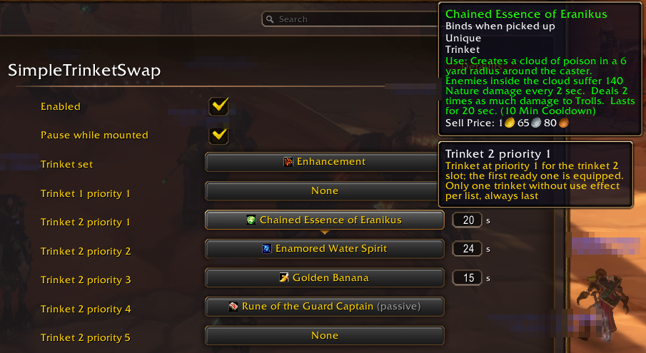

# SimpleTrinketSwap

Equips your on-use trinkets by a priority list per trinket slot, swapping as soon as you
are out of combat.

## Features

- **Priority list per slot** - up to ten trinkets for each trinket slot; a trinket may
  be in both lists, slot 1 picks first. The settings page shows one empty position more
  than are filled.
- **Passive filler** - one trinket without use effect per list, always last; it is worn
  while every on-use trinket above it is on cooldown.
- **Automatic swaps** - out of combat, each slot gets the highest-priority trinket that is
  ready (less than 30 s cooldown left, the time equipping adds anyway); in combat the swap
  waits until combat ends. An empty list leaves its slot alone.
- **Mount pause** - optionally no swaps while mounted, so addons that equip mount gear
  are not disturbed.
- **Hold time** - a seconds box next to each trinket on the settings page: after its use
  the trinket stays equipped that long, counted also during combat.
- **Trinket sets** - one set per equipment set of the game's equipment manager; equipping
  an equipment set activates its trinket set. Without equipment sets there is only the
  Default set.
- **Remembered** - all settings and trinket sets are saved per character; swapping is off
  by default.
- **Settings page** - all options, including the lists, in the game menu under
  Options > AddOns, also opened from the addon compartment menu; hovering a trinket shows
  its item tooltip above the help text.
- **Chat commands** - every option can also be changed by slash command.

## Screenshots



## Install

1. Download `SimpleTrinketSwap-vX.Y.Z.zip` from the
   [releases](https://github.com/tf4482/SimpleTrinketSwap/releases) (or CurseForge, Wago).
2. Unzip it into `World of Warcraft/_forever_/Interface/AddOns/`.
3. Restart the game or type `/reload`.

## Usage

```text
/sts                        show the state and the edited set's lists
/sts on                     turn swapping on
/sts off                    turn swapping off
/sts mount <on|off>         pause swaps while mounted, or not
/sts set                    list the trinket sets
/sts set <name|default>     edit the trinket set of an equipment set
/sts slot <1|2> [id ...]    replace a slot list with up to ten item IDs; none clears it
/sts hold <id> <seconds>    keep a trinket equipped that long after its use; 0 = off
/sts test                   check the lists and swap once now
/sts reset                  reset the settings to defaults; trinket lists stay
/sts debug on               show what the addon does, until /reload
/sts config                 open the settings page
/sts help                   list all commands
```

## Examples

- Two strong trinkets and a filler: Trinket 1 = A, then passive P; Trinket 2 = B, then P.
  After you use A, P goes into slot 1 at the end of the fight; once A is ready, it comes
  back.
- Raid and PvP gear: equip your "Raid" equipment set, pick the trinkets on the settings
  page, do the same for "PvP"; equipping a set switches the lists too.
- Edit a set by chat: `/sts set "Raid DD"`, then `/sts slot 1 12345 23456`.
- A trinket whose effect needs it worn for 20 s after use: enter 20 in the box next to it,
  or `/sts hold 12345 20`.
- Turn swapping off for a fight with fixed gear: `/sts off`, later `/sts on`.
- Check a list right after editing it: `/sts test`; with `/sts debug on` chat shows each
  swap and the next check.

## Develop

Check the code with [Luacheck](https://github.com/lunarmodules/luacheck) before each commit
(CI runs it on every push):

```text
luacheck .
```

Deploy locally: run `deploy.bat`; it builds `release/SimpleTrinketSwap-vX.Y.Z.zip` from
`VERSION`.

Release: set `VERSION` to `X.Y.Z`, then push an annotated tag `vX.Y.Z`; GitHub Actions
packages the addon with the BigWigs packager and publishes it.

## License

All rights reserved, see [LICENSE](LICENSE).
